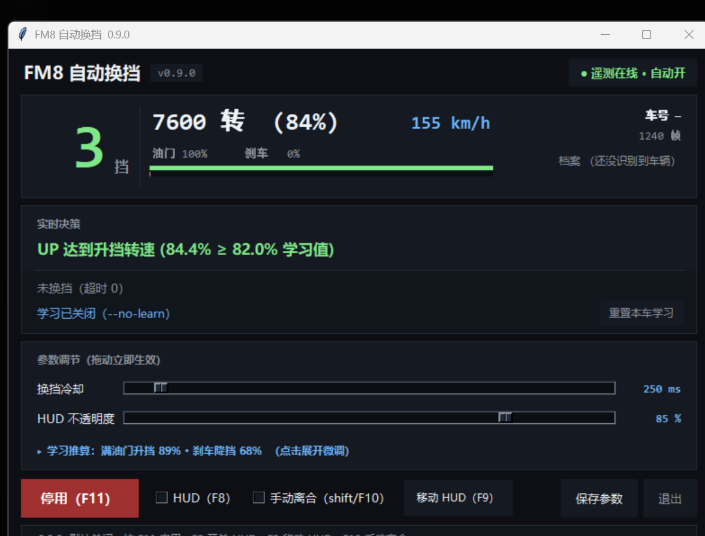

# FM8 自动换挡助手 (FM8 TCU)

> 面向 **《极限竞速》（Forza Motorsport 2023 / FM8）** 的外部自动换挡与车辆参数在线学习工具。
>
> **纯外部辅助**：只读游戏官方开放的本地 UDP 遥测（Data Out），只通过 Windows 原生键盘扫描码发键。
> **不读内存、不改游戏文件、不注入进程、不装虚拟手柄驱动。**


## 目录

- [项目简介](#项目简介)
- [核心功能](#核心功能)
- [环境要求](#环境要求)
- [快速开始（三步上手）](#快速开始三步上手)
- [界面与快捷键](#界面与快捷键)
- [进阶用法与命令行参数](#进阶用法与命令行参数)
- [配套工具](#配套工具)
- [安全机制](#安全机制)
- [项目结构](#项目结构)
- [设计文档](#设计文档)
- [常见问题](#常见问题)
- [免责声明](#免责声明)

## 项目简介

游戏自带的「自动挡」换挡时机偏保守，出弯降挡也慢；而不同车型、不同改装方案的
真实断油点、最佳升挡转速和齿比差别很大。

**FM8 TCU** 专注 **RACE（赛道驾驶）模式**：接管升降挡，并在你开车的 1–2 圈里
自动学习这台车的**各挡齿比、全油门扭矩曲线和真实断油转速**，据此推算换挡点。
项目由 AI 辅助编写，用于个人学习 Python、UDP 二进制协议解析和数值拟合。

## 核心功能

**多工况换挡引擎**

- **升挡**：综合油门深浅、学到的轮上推力交叉点、断油保护余量计算换挡点。
- **三种降挡**：重刹降挡（入弯主力）、给油动力降挡（出弯转速过低补救）、
  滑行降挡（收油过弯），外加静止自动回 1 挡。
- **防超转**：降挡前用实测齿比预估落点转速，有超转风险立即拦截。
- **减速防抖**：用 0.4 秒车速变化率判断趋势，避免降挡减速途中又升回去。

**按车号独立学习**

- **齿比**：稳态样本 + 中位数 + 离散度 + 单调性校验，用来预测降挡落点。
- **扭矩曲线**：按 100 RPM 分箱采集全油门样本，最小二乘拟合后计算物理最优升挡点。
- **真实断油点**：名义红线（`EngineMaxRpm`）通常高于实际断油；手动拉到断油 2 次即可确认。
- **顶挡探测**：在已学最高挡上留 +1 挡探索余量；连续两次无响应则锁定，90 秒后重试，
  且只拦升挡、不锁降挡。

**手动带离合**

游戏里是「手动带离合」时，换挡自动按
`挡位键按下 → 10ms → 离合按下 40ms → 离合松开 → 10ms → 挡位键松开` 执行，
总时长仍是 60ms（见 [`docs/08-手动离合.md`](docs/08-手动离合.md)）。

**60Hz 游戏内 HUD**

- 15 段 F1 风格转速灯：绿 7 / 黄 4 / 红 4，到升挡点整条 8Hz 蓝紫闪烁。
- 双层窗口：底板可调 30%–100% 透明，文字和灯始终不透明。
- 默认鼠标穿透、置顶、不进任务栏；F9 进入拖动模式。

**每一帧都能解释**

界面和 `decisions.csv` 写明这一帧为什么换挡，或被哪条规则拦住
（冷却中 / 防超转 / 减速中 / 防抖）。

## 环境要求

- **系统**：Windows 10 / 11（64 位）
- **游戏**：《极限竞速》Forza Motorsport 2023（Steam / 微软商店 / XGP 均可）
- **运行**：
  - 用打包版 EXE：不需要装任何东西。
  - 跑源码：Python 3.8+（安装时勾选 `tcl/tk and IDLE` 和 `Add python.exe to PATH`）。
    **运行零第三方依赖**，不用 `pip install`。

## 快速开始（三步上手）

### 第一步：游戏内设置（只需一次）

1. **换挡改手动**：`设置 → 难度与辅助 → 换挡` 改为 **手动**，或 **手动带离合**。
   留在「自动」会和本程序抢控制权。
2. **确认键位**：程序默认发 FM8 键盘默认键——升挡 `num9`、降挡 `num7`、离合 `Left Shift`。
   **用小键盘时确认 NumLock 灯亮着**。用手柄/方向盘开车也可以，键盘码不影响转向和油门。
3. **打开遥测**：`设置 → 游戏玩法与 HUD → UDP 竞速遥测`
   - Data Out：**开**
   - IP：`127.0.0.1`　端口：`5300`　格式：**`Dash`**（不要选 Sled）
4. **想用 HUD 就把显示模式改成「无边框窗口」**——独占全屏下任何浮窗都画不上去。

### 第二步：启动

| 方式 | 需要 Python | 怎么做 |
| :--- | :--- | :--- |
| **A. 直接跑 EXE** | 不需要 | 到仓库右侧 **Releases** 下载 `FM8自动换挡.exe`；或自己运行 `tools\打包exe.bat` 生成 |
| **B. 双击批处理跑源码** | 3.8+ | 双击 `tools\自动换挡.bat`（自动找 Python 并打开界面） |
| **C. 命令行模式** | 3.8+ | 双击 `tools\命令行模式.bat`，控制台面板 + 简版浮窗 |

### 第三步：上赛道

1. **把车开上赛道**（主菜单、改装、暂停界面不发有效遥测）。
   右上角变成 `● 遥测在线 · 只读`，挡位/转速/车速开始跳。
2. **可选 HUD**：勾选 `HUD（F8）` 或按 **F8**；按 **F9** 后用鼠标拖动，再按 F9 锁定。
3. **先观察**：程序默认**不发键**。跑几个弯看「实时决策」——关闭状态下它仍按完整规则
   （含冷却、防抖）计算，只是不按键。
4. **正式启用**：按 **F11** 或点蓝色按钮，状态变 `● 遥测在线 · 自动开`。
5. **手动带离合**：游戏里选了「手动带离合」就勾上 `手动离合（shift/F10）`，或按 **F10**。
6. **学习断油点**：想学真实断油转速，先按 F11 暂停，手动把任意一挡拉到断油（转速撞墙回弹）
   **2 次**，看到「断油 XX%」点亮后再按 F11 恢复。



## 界面与快捷键

### 全局热键（游戏内随时生效）

| 键 | 功能 | 说明 |
| :--- | :--- | :--- |
| **F11** | 启用 / 停用自动换挡 | 默认停用（只读）；再按一次随时停手 |
| **F8** | 开 / 关游戏内 HUD | |
| **F9** | 移动 HUD | 按住左键拖动，再按 F9 锁定并保存位置 |
| **F10** | 开 / 关手动离合 | 对应游戏内「手动带离合」 |
| **F12** | 退出 | 停止动作、抬起所有键、保存档案后退出 |

### 主要读数

| 区域 | 说明 |
| :--- | :--- |
| 15 段转速灯 | 绿 7 / 黄 4 / 红 4；满格 = `min(断油点, 满油门升挡点)`；到升挡点整条闪 |
| 挡位 / 转速 / 车速 | 实时遥测；括号里是相对名义红线的百分比 |
| 实时决策 | `UP` 绿、`DOWN` 黄、断流红、`HOLD` 白并附拦住它的规则 |
| 统计 | 成功率、延迟中位数、超时次数、防超转拦截次数 |
| 学习 / 重置 | 齿比覆盖、扭矩拟合度、断油点；右侧可一键清空本车档案 |
| 参数 | 换挡冷却、HUD 不透明度；折叠区里是满油门升挡 / 刹车降挡基准 |

## 进阶用法与命令行参数

```bat
:: 图形界面：换成 E/Q 换挡，离合用 Space
py -3 run_gui.py --keys e:q --clutch --clutch-key space

:: 命令行：带简版浮窗并记录日志
cd src
py -3 -m fm8_tcu.app --port 5300 --keys num9:num7 --overlay --log ..\decisions.csv

:: 导出一份默认参数
cd src
py -3 -m fm8_tcu.app --write-config ..\params.json
```

| 参数 | 默认 | 说明 |
| :--- | :--- | :--- |
| `--port` | `5300` | UDP 端口，要和游戏一致 |
| `--host` | `127.0.0.1` | 监听地址，默认只收本机 |
| `--allow-from` | 空 | `--host 0.0.0.0` 时显式放行的来源 IP（逗号分隔） |
| `--keys` | `num9:num7` | `升挡:降挡`，支持小键盘、字母、`[/]`、`,/./`、`shift/ctrl/space` |
| `--hold` | `60` | 按键按住总毫秒数 |
| `--clutch` | 关 | 启动即开启手动离合时序 |
| `--clutch-key` | `shift` | 离合键名，必须和游戏绑定一致 |
| `--clutch-hold` | `40` | 离合按住的毫秒数（含在 `--hold` 内） |
| `--no-focus-check` | 关 | 关闭「前台必须是 forza*」检查 |
| `--no-learn` | 关 | 关闭在线学习，只用固定阈值 |
| `--config` | 空 | 指定参数文件；不填时读 exe 旁的 `params.json` |

## 配套工具

`tools/` 下都是独立脚本，不参与自动换挡主流程：

- **`启动探针.bat`**（`probe.py`）：只读探针，不发键。查收包率、字段偏移、挡位分布。
- **`录制遥测.bat`**：把原始 UDP 录成 `.fm8rec`，供离线分析。
- **`手动换挡测试.bat`**（`manual_shift.py`）：F6 升 / F5 降，带提示音与毫秒回执，
  专门验证按键注入通道。
- **`replay_engine.py` / `replay_udp.py`**：不用开游戏，拿录制回放对比你的换挡点和引擎决策。
- **`打包exe.bat`**：锁定 PyInstaller 版本，打包成单文件 `dist\FM8自动换挡.exe`。

## 安全机制

程序会往系统注入按键，所以做了六道边界（详见 [`docs/07-安全审查修复.md`](docs/07-安全审查修复.md)）：

| 机制 | 行为 |
| :--- | :--- |
| **默认关闭** | 启动只读，必须按 F11 才发键 |
| **断流看门狗** | 超过 300ms 没遥测立即停手、作废待确认指令；恢复首帧也不发 |
| **只收本机** | 默认绑 `127.0.0.1` 并校验来源，其他来源丢弃并计数 |
| **前台检查** | 发键前确认前台是 `forza*`；切出去聊天不会乱按 |
| **事务回滚** | 没发出去的指令回滚引擎状态；抬键在 `finally`，退出时 `release_all()` |
| **坏帧过滤** | NaN / Inf / 挡位越界 / 负转速在解析层丢弃，不进学习器 |

## 项目结构

```text
fm8-tcu/
├── src/fm8_tcu/
│   ├── protocol.py          # 331 字节遥测解析与合理性校验（偏移表是唯一真源）
│   ├── engine.py            # 换挡决策：规则、防抖、冷却、回执结算、顶挡推断
│   ├── service.py           # 收包去重、看门狗、学习调度、发键门控、日志轮转
│   ├── outputs.py           # SendInput 扫描码注入、手动离合时序、热键
│   ├── gui.py               # Tkinter 主界面
│   ├── hud.py               # 游戏内双层 HUD 与 15 段转速灯
│   ├── overlay.py           # 命令行版置顶浮窗（穿透/定位）
│   ├── app.py               # 命令行面板
│   ├── config.py            # params.json 读写与范围/NaN 校验
│   ├── profile.py           # 车辆档案原子读写
│   ├── ui_prefs.py          # ui.json 原子读写
│   └── learning/            # 齿比、扭矩曲线、断油点、车辆模型
├── tools/                   # 探针、录制回放、手动换挡测试、启动与打包脚本
├── tests/                   # 6 套脚本、313 条断言（不依赖 pytest）
├── docs/                    # 阶段 1–9 的设计与实测记录
├── LICENSE
└── run_gui.py               # 打包入口 + 启动期崩溃日志
```

## 设计文档

- [`docs/阶段1-技术方案与移植计划.md`](docs/阶段1-技术方案与移植计划.md)：协议偏移推算与架构设计
- [`docs/01-协议实测记录.md`](docs/01-协议实测记录.md)：331 字节包的实测结论
- [`docs/02-阶段2-探针使用说明.md`](docs/02-阶段2-探针使用说明.md)：只读探针
- [`docs/03-阶段3-手动换挡测试.md`](docs/03-阶段3-手动换挡测试.md)：扫描码注入可行性与延迟
- [`docs/04-阶段4-自动换挡.md`](docs/04-阶段4-自动换挡.md)：换挡规则与参数来源
- [`docs/05-阶段5-车辆适配.md`](docs/05-阶段5-车辆适配.md)：齿比/扭矩/断油学习算法
- [`docs/06-阶段6-界面与打包.md`](docs/06-阶段6-界面与打包.md)：GUI、HUD、打包
- [`docs/07-安全审查修复.md`](docs/07-安全审查修复.md)：两轮审查的修复记录
- [`docs/08-手动离合.md`](docs/08-手动离合.md)：三段式离合时序
- [`docs/09-界面重构与复审补丁.md`](docs/09-界面重构与复审补丁.md)：v0.9 界面重构与取舍

## 常见问题

**一直显示「等待遥测」**

车没上赛道，或 Data Out 没开 / IP 端口不对 / 格式不是 Dash；也可能 5300 被 SimHub、探针占用。

**显示在线、也有 UP/DOWN，但车不换挡**

1. 没按 F11（必须显示「自动开」才发键）。
2. 游戏换挡不是「手动」；选了「手动带离合」还要勾程序里的手动离合。
3. NumLock 没亮，`num9/num7` 变成了翻页键。
4. 游戏以管理员运行，程序也要以管理员运行。
5. 决策行提示「前台是 xxx，不是游戏」——游戏进程名特殊时用 `--no-focus-check`。

**HUD 看不到**

游戏是独占全屏。改无边框窗口；仍被盖住就在游戏 exe 的兼容性里勾「禁用全屏优化」。

**改装后学习数据不准**

遥测只给车型编号（`CarOrdinal`），不区分改装。点「重置本车学习」重学即可。

**Defender 报毒**

PyInstaller 单文件、无签名，常见误报。不放心就跑源码（`tools\自动换挡.bat`）。

## 出处与声明

本项目为**独立实现**。设计阶段参考过下面两个项目**公开的文档与行为**，
但未复制、翻译或包含其任何源代码：

| 项目 | 参考内容 | 授权状态 |
| :--- | :--- | :--- |
| [fh6-virtual_tcu](https://github.com/Forza-Love/fh6-virtual_tcu) | 换挡策略的工程取舍（如看门狗、失败可见性） | AGPL-3.0，**未使用其代码** |
| [forza-horizon-6-tgt2-shifter](https://github.com/Yuandiaodiaodiao/forza-horizon-6-tgt2-shifter) | 手动离合的按键顺序（10/40/10 ms） | 未声明许可，**未使用其代码** |

参考仓库只存在于开发者的本地环境（`reference/` 已加入 `.gitignore`），不随本仓库分发。
遥测字段偏移来自游戏接口本身，并经过 3560 帧实测交叉校验（`docs/01`）；
协议布局、物理公式和按键时序属于接口事实与功能方法，不构成本项目的表达性代码。

**非官方项目**：与 Microsoft、Turn 10 Studios、Playground Games 均无关联，
未获其授权或认可。“Forza”“Forza Motorsport”等是其各自权利人的商标，
本项目仅在描述兼容对象时使用。

## 免责声明

1. **个人学习用途**：本项目用于学习 Python、UDP 二进制解析、数值拟合与软件测试。
2. **合规风险**：程序不读内存、不改游戏文件，只使用官方 Data Out 与系统键盘输入；
   但在**线上比赛/排行榜**使用自动化辅助可能违反 Forza 行为准则。
   **建议只在单机、生涯或私人练习中使用**，账号风险由使用者自行承担。
3. **无担保**：按「原样（AS IS）」提供，不附带任何明示或暗示担保。
4. **非官方**：本项目不是 Microsoft / Turn 10 / Playground Games 的官方产品，相关商标归其权利人所有。

## 许可证

[MIT](LICENSE)。使用前请阅读免责声明。
