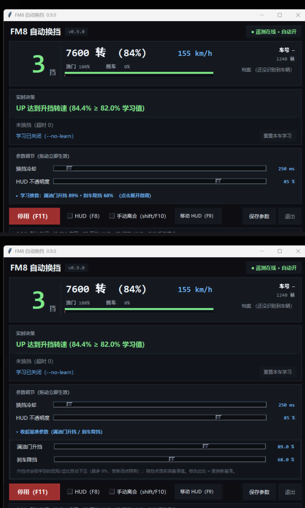

# 阶段 6：图形界面、日志与安装包

前五个阶段的东西都能用，但只能对着黑底白字的控制台。这一阶段把它变成
**双击就能开、能看、能调**的东西，并且打包成一个 exe。

---

## 一、现在有三个入口，都能用

| 文件 | 是什么 | 什么时候用 |
|---|---|---|
| `dist\FM8自动换挡.exe` | 打包好的单文件程序，**不需要装 Python** | 日常用这个 |
| `tools\自动换挡.bat` | 用源码启动图形界面 | 改了代码之后 |
| `tools\命令行模式.bat` | 控制台面板 + 游戏内浮窗 | 想看滚动的诊断信息 |

三个入口跑的是**同一套逻辑**（`service.py`），所以行为完全一致。

---

## 二、界面怎么读

```
┌──────────────────────────────────────────────────────────────────┐
│ FM8 自动换挡  v0.9.0                        ● 遥测在线 · 自动开    │
├──────────────────────────────────────────────────────────────────┤
│ ┌────────┐  7600 转  (84%)                  车号 car03240        │
│ │        │  155 km/h                        1240 帧              │
│ │   3    │  油门 100%    刹车   0%          档案 …\car03240.json │
│ │   挡   │  ██████████████  ░░░░░░░░░░░░                        │
│ └────────┘                                                       │
├──────────────────────────────────────────────────────────────────┤
│ 实时决策                                                         │
│ UP 达到升挡转速 (84.4% ≥ 82.0%)        ← 绿=升挡 / 黄=降挡 / 红=断流 │
│ ──────────────────────────────────────────────────────────────── │
│ 换挡 42/42 成功  中位 129ms  超时 0            [重置本车学习]    │
│ 齿比 1-6 挡 · 扭矩 96% · 断油 91.9%                              │
├──────────────────────────────────────────────────────────────────┤
│ 参数调节（拖动立即生效）                                         │
│ 换挡冷却      [═══════●═══════════════]                250 ms    │
│ HUD 不透明度  [════════════●══════════]                 85 %     │
│ ▸ 学习推算：满油门升挡 89% · 刹车降挡 68%  （点击展开微调）      │
├──────────────────────────────────────────────────────────────────┤
│ [启用 F11] □ HUD(F8) □ 手动离合(shift/F10) [移动 HUD(F9)] [保存参数] [退出] │
├──────────────────────────────────────────────────────────────────┤
│ v0.9.0 默认关闭，按 F11 启用；F8 开关 HUD；F9 移动 HUD；F10 手动离合 │
└──────────────────────────────────────────────────────────────────┘
```

几个要点：

- **启动时自动换挡是关的**。必须按 F11 或点蓝色按钮才生效。这是刻意的：
  程序启动时你还没坐好，它不该开始动挡。
- **关着的时候照样显示判断结果**。没启用时引擎不等待回执（不设 pending），
  但冷却、防抖、顶挡这些状态照常更新——所以你看到的是**开着时的真实换挡序列**，
  不是"每帧独立判断"。这本身就是观察模式，不需要单独的"演练"开关。
- **「决策」那一行永远在解释自己**。换挡时写为什么换，不换时写被哪条规则挡住。
- **参数滑块**拖动立即生效，不用重启。点「保存参数」写到 `params.json`，
  下次启动自动带上（用 `--config` 或 exe 旁边的 `params.json`）。
- **「满油门升挡 / 刹车降挡」默认收起**。升挡点会在学到的扭矩/齿比之上自动
  下压（最多 8%，并受断油点限制），降挡点是从真实驾驶里量出来的基准——
  两个都不是日常要调的东西。收起时按钮上仍写着当前用的值，点开才能手动覆盖。
- **「手动离合」勾选框**：游戏里变速箱设成「手动带离合」时勾上，换挡会按
  `挡位按下 → 10ms → 离合 40ms → 10ms → 挡位抬起` 的时序走（`docs/08`）。
  勾选状态记在 `ui.json`，也可以按 **F10** 切换。
- **数字统一等宽字体**，油门/刹车是真正的进度条而不是 `█░` 字符，
  决策行按动作着色（绿=升挡、黄=降挡、红=断流）。
- 窗口标题栏关掉 = 退出，会先把学习档案存盘。



### HUD（游戏内小窗）

勾上「HUD（游戏内，F8）」，左上角（默认 30,30）会弹出一个小窗：

```
┌────────────────────────────────────┐
│ ■■■■■■■■■■■■□□□                    │  ← 15 段转速灯
│            7650 RPM                │
│  4   158 km/h                      │
│ 挡                                  │
│ 油门 ████████░░░░  72%             │
│ 刹车 ░░░░░░░░░░░░   0%             │
│ ────────────────────────────────   │
│ HOLD 在功率带内  (70%)             │
│ 换挡 42/42 成功  中位 129ms  超时 0│
│ 齿比 1-6 挡 · 扭矩 96% · 断油 91.9%│
│ car03240 · 自动：开 · F8 关闭       │
└────────────────────────────────────┘
```

### 转速条：15 段，按区间变色

| 位置（相对断油点） | 颜色 | 说明 |
|---|---|---|
| 灯条位置 | 颜色 | 说明 |
|---|---|---|
| 0.50 以下 | 全灭 | 怠速/低速，看数字就够了 |
| 0.50–0.75 | 绿 7 段 | 巡航 |
| 0.75–0.90 | 黄 4 段 | 加速 |
| 0.90–0.965 | 红 4 段 | 临界 |
| 满格 / 到达升挡点 | 全条蓝紫闪 8Hz | 该升挡了 |

几个刻意的决定：

- **满格 = `min(断油点, 满油门升挡点)`，谁先到用谁。**
  只看断油点不行：自动换挡在升挡点就把转速切走了，而红区（0.90）
  落在升挡点之上——灯条永远亮不到红色。真实录制 4265 帧里红区只有
  26 帧，还是手动拉到断油才出现的。改装车可能断油比升挡点还早，
  所以取 min 而不是固定一个。
- **颜色跟位置走，不是整条变色。** 亮到绿区就是绿，推到红区才红。所以
  "亮到第几个"直接就是"转速到哪了"，不用读数字。
- **阈值按区间分配，不是平均分。** 0.75 时正好 7 个绿灯全亮，0.90 时黄灯也满。
  平均分会出现"说好 75% 变黄，结果 73% 就黄了"。
- **数字只显示 RPM，不显示百分比。** 百分比是相对名义红线的，灯条的分母是断油点，
  两个数放一起会打架（90% 时灯条已经全红了，因为断油在 91.9%）。
- **HUD 独立约 60Hz 刷新。** 主窗口仍是 20Hz；HUD 由单独 16ms 定时链驱动，
  不增加工作线程，也不额外轮询遥测或改变换挡节奏。
- **RPM 数字用 40ms 时间常数轻平滑，灯条不平滑。** 首个有效样本直接显示，
  后续按单调时间推进指数滤波；数字还在追赶时，灯段和换挡闪烁已经按最新转速响应。
- **闪烁由 `tick()` 驱动，不绑在数据刷新上。** 8Hz 相位按绝对单调时间计算，
  每 62.5ms 切换亮灭；数据慢一拍或界面卡顿也不会靠补帧累积漂移。
- 无数据、换挡中（挡位 11）、菜单帧和遥测断流时全灭，RPM 显示 `—` 并清空滤波状态；
  恢复后的第一帧直接显示新转速，不从旧值缓慢爬升。

颜色用 Canvas 画在文字层上：Canvas 背景也是 `#000000`，会被色键整块抠掉，
只留下彩色矩形。所以转速条和文字一样是 100% 不透明的。

三个性质都实测过，不是设了标志位就算：

| 性质 | 为什么必须 | 验证方式 |
|---|---|---|
| **鼠标穿透** | 点到它就切出游戏，FM8 会暂停 | 读回 `WS_EX_TRANSPARENT` |
| **置顶** | 游戏窗口自己也带 TOPMOST，会抢层级 | 读回 `WS_EX_TOPMOST` + 每 0.5 秒重申 |
| **不进任务栏** | 工具窗不该出现在 Alt+Tab | 读回 `WS_EX_TOOLWINDOW` |

- **F8** 随时开关，不用切回主窗口
- **底板不透明度**用界面上的「HUD 不透明度」滑杆调，0.30–1.00 拖动立即生效；
  也能用 `--hud-alpha 0.7` 指定启动值。低于 0.30 会看不清字，所以设了下限
- 调的是**黑底**，文字永远是 100% 不透明。做法是拆成两层窗口：
  底层纯黑矩形用 `-alpha` 调透明（`LWA_ALPHA`），
  上层只画文字、背景色 `#000000` 交给 `-transparentcolor` 抠掉（`LWA_COLORKEY`）
  —— 单窗口的 `-alpha` 会把字一起变淡，满足不了这个需求
- **移动**：点「移动 HUD（F9）」或直接按 **F9** 进入移动模式，在 HUD 上按住左键拖；
  再按一次 F9 结束。位置和底板不透明度会存进 `ui.json`，下次启动自动恢复
  （`--hud-pos` / `--hud-alpha` 可以覆盖）
- HUD 平时是**鼠标穿透**的——点得到它就等于切出游戏。所以拖动要先进移动模式，
  否则在游戏里随手一点就会把 HUD 拖走
- 和命令行浮窗（`overlay.py`）共用同一份窗口设置代码，避免两处各写一套

> 同样受限于渲染：**独占全屏下画不上去**，游戏要改成无边框窗口。

---

## 三、打包

```bat
tools\打包exe.bat
```

它会做三件事：装 PyInstaller（已装则跳过）→ 打包 → 告诉你 exe 在哪。

产物：`dist\FM8自动换挡.exe`，**7.7 MB 单文件**，复制到任何 Windows 电脑都能双击运行，
目标机器不需要装 Python。

打包时处理的几个坑：

| 坑 | 处理 |
|---|---|
| exe 里的 `__file__` 指向临时解压目录，档案会写丢 | `service.py` 里判断 `sys.frozen`，改用 exe 所在目录 |
| 双击后弹黑框 | `--windowed`，不带控制台 |
| 中文文件名 | 已实测可用（`FM8自动换挡.exe`） |
| 首次启动慢 1–2 秒 | 单文件模式要先解压，正常现象 |

> 如果 Windows Defender 报毒：PyInstaller 打包的程序经常被误报，
> 添加信任即可。要发布给别人时应该做代码签名，这超出本项目范围。

---

## 四、日志怎么读

`decisions.csv`，每次运行追加。列：

| 列 | 含义 |
|---|---|
| 时间s | 本次启动后的秒数 |
| 动作 | `UP` / `DOWN` / `HOLD`（没换） |
| 起始挡 | 动作发生时的挡位 |
| 结果 | 成功 / 失败 / — |
| 延迟ms | 从发指令到看见挡位变化 |
| 原因 | 触发原因，**带当时的车速和转速** |

`HOLD` 行只在状态变化时写（否则 85 帧/秒会把文件刷爆），所以它记录的是
"这一刻开始被某条规则挡住"，不是每一帧。

读日志的正确顺序：

1. 先数 `失败` 有几行 —— 这是唯一的硬指标
2. 再看失败的 `原因` 里那串 `@xxkm/h xxx转` —— 能判断当时车在什么状态
3. 最后看 `HOLD` 的分布 —— 判断是不是"该降没降"或"该升没升"

---

## 五、这一阶段顺带修的两个问题

### 5.1 降挡后又升回去

上次日志里有一次 3→2→3 来回：

```
83.479s  DOWN 3挡  刹车 100%，转速仅 66% @163km/h 5940转
84.089s  UP   2挡  达到升挡转速 @146km/h 7679转
```

降挡后 0.61 秒，车速从 163 掉到 146（还在减速），却又被升回 3 挡。
原来的防抖只按**时间**（降挡后 0.6 秒内不许升），刚好卡在边界上。

第一版改成了「降挡后 4 秒内，车速要回到降挡时的水平」，结果**引入了一个死锁**：

> 3 挡 163 km/h 降到 2 挡，而 2 挡跑到断油只有 159 km/h，
> 车速永远回不到 163 → 4 秒内一直不许升挡 → 顶着断油跑。

实跑日志里出现了 15 次，其中 6 次持续 **3.1–3.5 秒**（就是那个 4 秒窗口）。

最终改成按**车速趋势**判断：

> 最近 0.4 秒的车速变化率低于 −3 km/h/s（还在明显减速）时不升挡。
> 但油门 ≥ 80% 时不看这条——全油门顶着断油跑，哪怕上坡让车速掉一点点，也必须升挡。

这个判据不会死锁——到断油时车速基本是平的（趋势约 0），允许升挡；
而重刹降挡时车速在掉（−20 以上），照样拦得住。

### 5.2 日志看不出"为什么顶着断油"

`HOLD` 行原来只写原因，不写当时的数据。现在也带上车速转速：

```
HOLD 3 — 0 刚降挡，但车速在下降 / decelerating @147km/h 5814转
```

下次再遇到"该升没升"，直接看那一行的转速就知道是不是卡在某个规则上。

**教训**：用"绝对值"当判据之前，先想一遍它有没有可能永远达不到。
换成"变化率"通常更安全，因为它衡量的是状态，不是位置。

---

## 六、测试

| 文件 | 断言数 | 覆盖什么 |
|---|---|---|
| `tests/test_engine.py` | 52 | 换挡规则、防抖、冷却、超时、减速判据、顶挡不锁降挡、不等待回执 |
| `tests/test_learning.py` | 86 | 齿比/扭矩/断油学习、档案往返与版本校验、参数解析 |
| `tests/test_service.py` | 52 | 收包去重、坏包计数、断流看门狗、来源白名单、启用门控、日志轮转、档案保存、离合开关 |
| `tests/test_gui_smoke.py` | 87 | 窗口能建、标签跟着数据变、按钮滑块接线、HUD 弹出与穿透、转速条、离合开关 |
| `tests/test_outputs.py` | 20 | 按键时序：普通换挡、手动离合的三段时长与顺序、失败抬键、退出释放 |
| `tests/test_shift_tracker.py` | 14 | 阶段 3 的回执逻辑 |

```bat
python tests\test_engine.py
python tests\test_learning.py
python tests\test_service.py
py -3 tests\test_gui_smoke.py     （界面测试要用带 tkinter 的 Python）
```

`test_gui_smoke.py` 在没 tkinter 的 Python 下会自动跳过，不会报错。

---

## 七、已知限制

1. **界面和 HUD 不能覆盖在独占全屏的游戏上**。要游戏内可见，显示模式必须改成
   无边框窗口/窗口化。
2. **窗口不能缩放**到很小（布局是固定像素的）。高 DPI 屏上字可能偏小，
   可以在 Windows 显示设置里给这个程序单独设缩放。
3. **exe 里没有自动更新**。改了代码要重新打包。
4. **参数滑块只有三个**（最常调的）。其余参数改 `params.json`。
5. **`decisions.csv` 会一直追加**。跑多了可以手动删掉或改名，程序会重新建。

---

## 八、如果你想继续改

- 改换挡曲线 → `src/fm8_tcu/engine.py` 的 `_rules()`，改完先跑 `tests/test_engine.py`
- 改学习算法 → `src/fm8_tcu/learning/`，每个文件对应一件事，互不牵连
- 改界面 → `src/fm8_tcu/gui.py`，只管显示，不碰逻辑
- 加新参数 → `Policy` 加字段 + `config.RULES` 加范围，两处都要

**改之前先提交一次**（`git add -A && git commit -m "..."`），改坏了能退回来。
