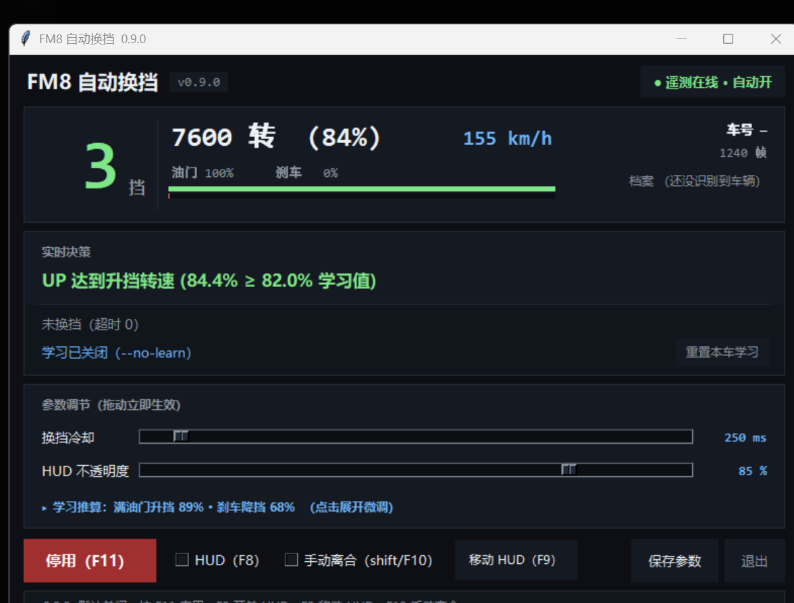
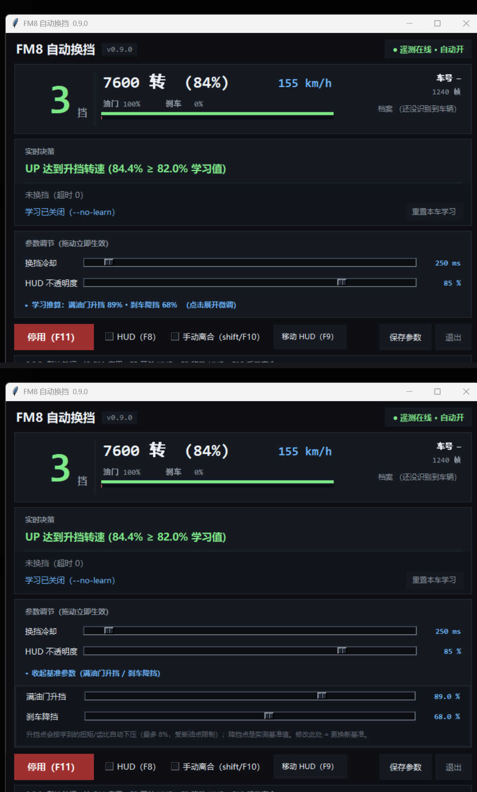

# 阶段 9：界面重构与复审补丁（v0.9.0）

外部审查给了一份 UI 排版方案和六项逻辑结论。逐条核对后的处理如下：
**成立了 5 条、修好；有 3 条判断不成立或不必要，没改，理由写在下面。**

## 一、界面重构

### 主窗口

```
┌────────────────────────────────────────────────────────────────────┐
│ FM8 自动换挡  v0.9.0                          ● 遥测在线 · 自动开   │
├────────────────────────────────────────────────────────────────────┤
│ ┌────────┐  7600 转  (84%)                    车号 car03240        │
│ │        │  155 km/h                          1240 帧             │
│ │   3    │  油门 100%    刹车   0%            档案 …\car03240.json │
│ │   挡   │  ██████████████  ░░░░░░░░░░░░                          │
│ └────────┘                                                        │
├────────────────────────────────────────────────────────────────────┤
│ 实时决策                                                          │
│ UP 达到升挡转速 (84.4% ≥ 82.0% 学习值)        ← 按动作着色          │
│ ────────────────────────────────────────────────────────────────── │
│ 换挡 42/42 成功  中位 129ms  超时 0            [重置本车学习]      │
│ 齿比 1-6 挡 · 扭矩 96% · 断油 91.9%                                │
├────────────────────────────────────────────────────────────────────┤
│ 参数调节（拖动立即生效）                                           │
│ 换挡冷却      [═══════●════════════]                     250 ms   │
│ HUD 不透明度  [════════════●═══════]                      85 %    │
│ ▸ 学习推算：满油门升挡 89% · 刹车降挡 68%  （点击展开微调）        │
├────────────────────────────────────────────────────────────────────┤
│ [停用 F11] □ HUD(F8) □ 手动离合(shift/F10) [移动 HUD(F9)] [保存][退出] │
├────────────────────────────────────────────────────────────────────┤
│ v0.9.0 默认关闭，按 F11 启用；F8 开关 HUD；F9 移动 HUD；F10 手动离合 │
└────────────────────────────────────────────────────────────────────┘
```

具体改动：

1. **数字全部改用等宽字体**（Consolas）。原来用雅黑，`900 转 (10%)` → `8250 转 (92%)`
   时列宽会变，整行视觉重心左右晃。
2. **踏板条从 `█░` 字符改成真正的进度条**（两个 `Frame` 的 `relwidth`）。
   字符条在不同字体回退下宽窄不一，看起来像一排灰块；现在是一条干净的绿/红条。
3. **顶部三栏改成 grid**，右侧档案路径固定两行高并只显示尾部：
   退到 `%LOCALAPPDATA%` 时长路径换行会把整个卡片撑高，窗口跟着跳。
4. **卡片 1px 描边**、统计/学习并入决策卡片、重置按钮加边框（看起来像按钮）。
5. **滑块去掉原生裸数字**，右侧独立读数带单位（`250 ms` / `85 %` / `89.0 %`）；
   轨道加深、滑块加立体边，折叠时也看得见当前值。
6. **补上 F10 热键**（图形界面原来只有命令行支持），复选框文案标出键名。
7. **独立底栏**放状态提示，不再和按钮挤在一起。





### HUD

从"上紧下松"改成座舱式布局：

- 左侧 44pt 大挡位（原 34pt），右下角小"挡"字。
- 右上：转速（17pt）与车速（15pt）**同一行**，视线不用上下跳。
- 右下：油门/刹车紧贴转速下方，有油门时变绿、有刹车时变红。
- 决策行按动作着色：`UP` 绿、`DOWN` 琥珀、断流红、其余白。
- 尺寸仍是 356×204，15 段灯条位置不变。

## 二、逻辑补丁

| 项 | 结论 | 处理 |
|---|---|---|
| `dump_policy` 非原子写 | 成立 | 改 `.tmp` + `os.replace`，和档案/偏好一致 |
| GUI 漏了 F10 热键 | 成立 | 抽出 `_handle_hotkeys()`，补 F10，并加测试 |
| 勾离合不落盘 | 成立 | `_on_clutch()` 里立即 `_save_prefs()` |
| 双击启动看不到 params 告警 | 成立 | `if args.config and notes` → `if notes` |
| 发键后继续消费同批旧包 | 部分成立 | `_decide()` 返回是否真的发键，`poll()` 见 `True` 立即 `break` |
| 跳挡污染统计 | 判断不同 | 不改成"必须单步"：挡位一次跳两级仍然是朝我们的方向走了，判失败反而冤枉。改成在记录原因里标 `·跳2挡`，统计口径不变 |
| 学习档案丢稳态样本 | 不成立（影响极小） | 还原后重新攒 30 个稳态样本约 0.5 秒，为此改存档格式不值 |

### 关于"同批收包导致延迟 0ms"

审查说：发键阻塞 60ms 后，紧接着读出的积压包时间戳与发键时刻相同，
结算出 `0ms` 延迟。

核对代码后**这个结论不成立**：`now = time.monotonic()` 是在 `recvfrom()`
之后取的，而 `recvfrom()` 发生在 `shift()` 睡完 60ms 之后，所以结算出的
延迟至少是 60ms，不会是 0。

但仍然采纳了"发键后结束本轮 `poll()`"：那些包是**发键之前**采到的旧帧，
拿它们去结算刚发出的指令，语义上就是错的（可能把发键前的挡位变化当成回执）。
这是"语义正确"的修复，不是"延迟统计"的修复。

### 关于"跳挡必须单步才算成功"

审查建议 `ok = (moved == 1)`。没有采纳，理由：

- 玩家在同一刻也拨了一下，挡位从 3 直接到 5，车确实朝我们要的方向走了。
  判失败会让"成功率"显示成失败，而用户什么都没做错。
- 更糟的是，如果以后有人把 `ok=False` 接到"顶挡推断"上，两次跳挡就能把
  顶挡钉在 3 挡——那正是之前修过的坑。

折中：`ok` 保持方向判断，记录里加 `·跳N挡`，日志和统计能看出异常。

## 三、测试

301 → **311**（engine 52 / learning 86 / service 52 / outputs 20 / tracker 14 / gui 87）。

新增的断言：

- 跳挡记录被标注（方向对 + `跳2挡`）
- `dump_policy` 原子写、不留 `.tmp`
- 勾选离合立刻写入 `ui.json`
- `F10` 切换手动离合、`F11` 仍然管用
- 界面/ HUD 的布局断言沿用原有 87 条，全部保持通过

## 四、没做的事

- **没有直接采用审查给的整份 `gui.py`**：那份代码里 `self.bars` 与 Canvas
  踏板条宽度不一致、`self.profile` 没固定高度会撑高卡片、滑块的
  `showvalue=False` 但没给单位读数——都在这版里逐项修掉了。
- **HUD 没有改成"转速居中"**：测试和实际观感都依赖"转速是主角"，
  这版把它做成右上与车速并列，字号仍大于车速。
